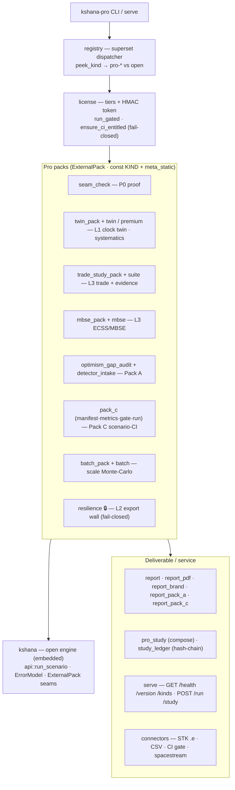
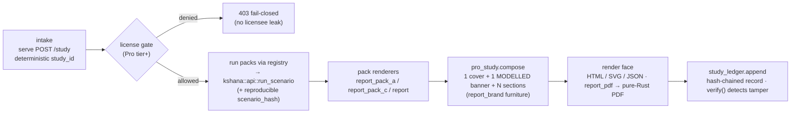
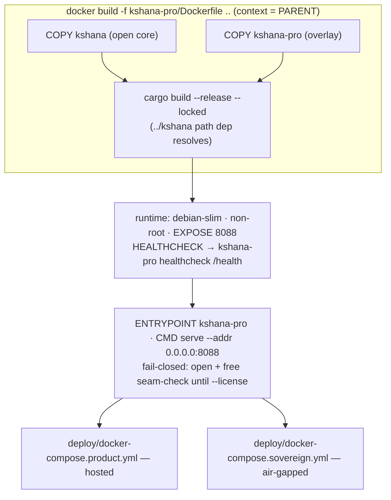

# Kshana Pro — Overlay Architecture

How the proprietary overlay attaches to the open Kshana engine **without forking
it**. This is the contract that makes Pro a strict superset of open Kshana and
keeps the two in lock-step forever.

> Internal/proprietary document. Not for the public repo.

---

## 0. Build status — overlay deepened to agency-grade (2026-06-30)

The overlay is no longer just seam-proof stubs; the substrates and the L1/L3
verticals are built to ESA/NASA-credible depth, **coordinated across the open
core and the private overlay**, behind one honesty firewall. What landed:

- **Two open substrates (public `kshana` main).**
  - `kshana::registry` — a `PackRegistry` dispatch seam (`ScenarioId` → factory)
    with `ExternalPack::register_into`, replacing closed enum-match dispatch.
  - `kshana::assurance` — `provenance` (W3C-PROV + Merkle root), `uncertainty`
    (Greenhall EDF + χ² CIs), `oracle` (the honesty-gate harness).
- **Superset attachment (Phase 0b).** `pro_registry()` = `PackRegistry::with_builtins()`
  ∪ the 7 Pro packs via each pack's `register_into` — open ∪ Pro is one table,
  proven additive (open + 7, no collision).
- **L1 clock twin (deepened).** Public `kshana::allan` gained **ThéoH/TOTVAR**
  (Theo1 + total deviation **Validated** vs allantools on NIST SP 1065, <1e-9) and
  **MTIE** (the ITU-T G.810/G.823/G.8261 telecom wander metric, **Validated** vs
  allantools, bit-exact); pro `twin` gained 3-parameter calibration (white-FM +
  flicker + RWFM/aging), a **9-preset device library spanning the clock hierarchy**
  (TCXO → OCXO → CSAC → Rb → Cs-beam → Galileo PHM → active H-maser → Galileo RAFS →
  optical lattice; only the CSAC SA.45s is datasheet-cited, the rest
  representative-class), holdover UQ vs ITU-T G.8272.1 masks, and an optical-lattice
  systematics budget.
- **L3 trade & assurance (deepened).** Public `kshana::mcda` is now the full
  four-family MCDA suite — **WSM, WPM, TOPSIS, VIKOR, PROMETHEE II** all **Validated**
  vs pymcdm and **ELECTRE I** **Validated** vs pyDecision (each <1e-9), plus **AHP +
  Consistency-Ratio** (vs Saaty-RI + SciPy/LAPACK), Pareto+knee, sensitivity
  tornado/SMAA, MAUT. Pro `suite` rewired single-FoM → multi-criteria on
  `kshana::mcda`, and adds a **multi-method concordance panel** (`suite::multi_method`)
  — the same trade run through the whole MCDA panel with pairwise **Kendall-τ**
  agreement (validated kernel), a consensus/unanimity winner and a rank-reversal
  count, so a recommendation can be shown robust to *method choice*. Plus W3C-PROV
  evidence packs, GSN + ECSS-E-ST-10-02C VCD, ECSS-E-ST-10C Annex L /
  NASA SP-2016-6105 §6.8 reports, ISO 16290 TRL knock-out, and a fail-closed
  multi-criteria assurance gate.
- **Agency V&V dossier (Phase 3).** `suite::vv_dossier` — NASA-STD-7009B
  Credibility Assessment Scale (8 factors) + ASME V&V 40 Context-of-Use,
  composing the L1+L3 evidence into one honest credibility statement.

**Honesty firewall (the load-bearing invariant).** Only open-core *kernels* with a
genuine independent external oracle are **Validated** (ADEV/ThéoH/TOTVAR/**MTIE** vs
allantools; WSM/WPM/TOPSIS/VIKOR/PROMETHEE II vs **pymcdm** and ELECTRE I vs
**pyDecision**; AHP vs Saaty-RI/SciPy-LAPACK — each with a committed generator, each
reproduced by an adversarial verifier in a clean venv). Every **composed** overlay
capability (device twins, the multi-method concordance panel, trade decisions,
evidence packs) is honestly **Modelled** — no flight or measured-device data. The V&V dossier scores the
overall model credibility at **NASA-STD-7009B level 1** by construction
(Validation capped because composition ≠ validation; Use History low because the
system is new), and states the credibility *gap* to an agency rather than hiding
it. Nothing is sold or labelled beyond its oracle.

---

## 1. The rule: depend, never fork

Kshana Pro is a separate **private** crate that lists the open `kshana` crate as a
dependency and extends it through the open core's **public, semver-stable trait
seams**. It never copies, vendors, or forks the open engine.

```
kshana-pro (private, proprietary)
  └── depends on ─▶ kshana (public, AGPL-3.0-only / commercial)  ← the whole validated engine
```

Consequence — **superset by construction**:
- Every open feature is present in a Pro build automatically (it *is* the open
  engine, embedded).
- A new open release is a one-line dependency bump; there is no merge, no drift,
  no conflict.
- Closed code physically cannot leak into the open tree (different repos).

### Dependency pinning
- **Now (transitional):** the overlay tracks the open core's `main`
  (`kshana = { git = "…/kshana", branch = "main", version = "0.23" }`) because the
  registry/assurance/mcda seams it depends on are merged to main but not yet in a
  crates.io release; `Cargo.lock` pins the exact rev for reproducibility and
  `cargo update -p kshana` advances it as each open-core phase lands.
- **Release:** pin the published crate (`kshana = "0.24"`) or a git tag once the
  open core cuts a release carrying the seams, so a Pro build is tied to an exact,
  released open engine.

---

## 2. The seams (already in the open core)

PR2 ("extension seams in open core") is **already satisfied** — these public
traits exist in `kshana` today and are documented as semver-stable in the open
core's own `docs/ARCHITECTURE.md` (§4 "Extending Kshana with an external pack",
§9 "A private overlay repo … plugs in via the same `ErrorModel` interface and the
`ExternalPack` contract without changing the public engine").

| Seam (open `kshana`) | Location | What Pro attaches with it |
|----------------------|----------|---------------------------|
| `api::Scenario` + `api::ExternalPack` | `src/api.rs` | New out-of-tree scenario packs (Pro packs, L3 meta-packs) |
| `models::ErrorModel` | `src/models.rs` | Device-calibrated clock/inertial twins (L1), real-parameter degradation models (L2) |
| `ephem_provider::EphemerisProvider` | `src/ephem_provider.rs` | Premium ephemeris (e.g. DE440 built-in, PR19) |
| `precise_od::ForceModel` | `src/precise_od.rs` | Higher-fidelity force models (PR19) |
| `propagator::Propagator` | `src/propagator.rs` | Alternative propagators |
| `lunar_od::LunarEnvironment` | `src/lunar_od.rs` | Lunar/cislunar environment extensions |

**No open-core change is required to stand up the overlay.** If a future Pro
feature needs a seam that does not yet exist, that becomes a small, additive,
semver-safe PR to the open core — demand-pulled by a concrete Pro need, never
speculative.

---

## 3. How a Pro pack plugs in (the proven pattern)

The P0 proof pack `packs::seam_check` is the worked example. Any Pro pack follows
the same three steps:

```rust
use kshana::api::{Scenario, ExternalPack, RunOutput, KshanaError, ScenarioMeta};

#[derive(serde::Deserialize)]
struct MyProPack { /* fields parsed from the scenario TOML */ }

impl MyProPack {
    // Convention: a `KIND` const + a `meta_static()` associated fn so the registry
    // can name and describe the pack without constructing one.
    pub const KIND: &'static str = "pro-my-pack";
    pub fn meta_static() -> ScenarioMeta { /* name: Self::KIND, description, fields */ }
}

impl Scenario for MyProPack {
    fn run(&self) -> Result<RunOutput, KshanaError> { /* compose open-engine calls */ }
}
impl ExternalPack for MyProPack {
    fn kind_name(&self) -> &'static str { Self::KIND }
    fn meta(&self) -> ScenarioMeta { Self::meta_static() }
}
```

Then add `register_into` to the pack's `impl ExternalPack` (one line —
`reg.register(crate::registry::pro_factory::<Self>(Self::KIND))`), and `pro_registry()`
seeds it alongside the open built-ins:

```rust
impl ExternalPack for MyProPack {
    fn kind_name(&self) -> &'static str { Self::KIND }
    fn meta(&self) -> ScenarioMeta { Self::meta_static() }
    fn register_into(reg: &mut kshana::registry::PackRegistry) {
        reg.register(crate::registry::pro_factory::<Self>(Self::KIND));
    }
}
```

`registry::pro_registry()` returns a `kshana::registry::PackRegistry` =
`PackRegistry::with_builtins()` (every open kind) driven through each Pro pack's
`register_into` — one table, open ∪ Pro, additive by construction (the
`registry::tests` prove union == open + Pro, no collision). The legacy
`registry::run`/`run_gated` string dispatcher (route `pro-*` to the pack, delegate
the rest to `kshana::api::run_scenario`) is retained and unchanged.

**Convention:** every Pro-only kind carries the `pro-` prefix
(`registry::PRO_KIND_PREFIX`). It makes routing unambiguous and Pro kinds obvious
in scenario files and logs.

---

## 4. Where each value layer attaches

The distinction that matters: the gated **capability** (a real customer instance / a
sold SKU / controlled data) vs the **framework** that capability plugs into. The
frameworks for L1 and L3 are **built as demonstrators** (runnable on public data, no
gate crossed); only the gated instances and all of L2 wait on triggers.

- **L1 — Quantum-payload digital twin** (`twin`, `packs::twin_pack`) — ✅ **deepened.**
  `twin::calibrate`/`calibrate3` fit a published Allan-deviation budget (white-FM +
  flicker floor + long-τ random-walk/aging) to an open-core `ClockModel` (an
  `ErrorModel`); `twin::validate` confirms reproduction via `kshana::allan` (now incl.
  ThéoH/TOTVAR + MTIE). `twin::presets` is a **9-device library** spanning the clock
  hierarchy — TCXO / OCXO / CSAC SA.45s / Rb PRS10 / Cs-beam 5071A / Galileo PHM /
  active H-maser / Galileo RAFS / optical-lattice — of which only the CSAC SA.45s is
  datasheet-cited, the rest representative-class (honestly flagged);
  `twin::holdover_uq` bands the open holdover against ITU-T G.8272.1 masks;
  `twin::optical_systematics` is a per-effect lattice shift budget. All **Modelled**
  (calibration/composition); the open ThéoH/TOTVAR + ADEV kernels are Validated.
  *Gated instance:* a twin of a specific customer's device needs NDA (and likely
  export-controlled) data — `twin::customer_instance_gated`. First instance =
  AO/1-13503 Foreground IP.
- **L2 — Export-sensitive resilience** (`resilience`) — 🔒 **gated stub (legal wall).**
  Real-parameter degradation + access-controlled packs, the closed twins of the open
  `jamming`/`spoof` packs. Trigger: export-control assessment (PR5) + cleared
  customer. Nothing built on spec — `resilience::gated`.
- **L3 — Trade-study & assurance suite** (`suite`, `packs::trade_study_pack`) — ✅
  **deepened.** `suite::run_trade_study` is now **multi-criteria** on `kshana::mcda`
  (`suite::decision`: WSM scoring, AHP-derived weights with the CR<0.10 gate surfaced,
  Pareto front + knee, sensitivity tornado/SMAA/min-weight-to-flip); a single-criterion
  study reproduces the old single-FoM ranking exactly. `suite::multi_method` re-runs
  the decision through the whole open-core MCDA panel (WSM/WPM/TOPSIS/VIKOR/PROMETHEE
  II) and scores their **concordance** — pairwise Kendall-τ (validated kernel),
  consensus/unanimous winner, rank-reversal count — so a recommendation can be shown
  robust to method choice, not just to weights. `suite::provenance` emits a
  W3C-PROV evidence pack with a Merkle root; `suite::gsn`/`suite::vcd` give a GSN
  argument + ECSS-E-ST-10-02C verification-control matrix; `suite::reports` renders
  ECSS-E-ST-10C Annex L + NASA SP-2016-6105 §6.8 + ISO 16290 TRL; `suite::gate` is a
  fail-closed multi-criteria assurance gate; `suite::vv_dossier` is the NASA-STD-7009B
  + ASME V&V 40 credibility dossier (§0). The open MCDA kernels (WSM/WPM/TOPSIS/VIKOR/
  PROMETHEE II/ELECTRE I/AHP) are Validated; the composed decision layer and the
  multi-method concordance panel are **Modelled**. *Gated:* packaging as a licensed SKU with
  full ECSS/MBSE generation — `suite::product_gated`. Trigger: second paying customer.
- **P0 — Seam proof** (`packs::seam_check`, `pro-seam-check`) — ✅ the smallest real
  `ExternalPack`; free at Evaluation, it exercises the whole overlay contract end-to-end.
- **L1 — Optical-clock systematics** (`premium`, `packs::quantum_systematics_pack`,
  `pro-quantum-systematics`) — ✅ framework built: a BBR / gravitational-redshift /
  Zeeman systematic-shift budget + uncertainty floor; species coefficients are *cited
  inputs*, never baked in.
- **Pack A — Optimism-gap audit** (`packs::{optimism_gap_audit, detector_intake}` +
  `report_pack_a`, `pro-optimism-gap-audit`) — ✅ the in- vs out-of-distribution detector
  audit packaged as a sold study (Pro tier).
- **Pack C — Scenario-subscription CI** (`pack_c::{manifest, metrics, gate, run}` +
  `report_pack_c`, run via `kshana-pro ci`, `pro-scenario-ci`) — ✅ a manifest of
  scenarios + metric thresholds gated against a rolling baseline (the JSON output is the
  next run's baseline). Entitlement: `license::ensure_ci_entitled` (Pro tier).
- **Scale — Batch Monte-Carlo** (`batch`, `packs::batch_pack`, `pro-batch`) — ✅ fans one
  base scenario across many seeds and aggregates a figure of merit (Enterprise tier).
- **ECSS/MBSE** (`mbse`, `packs::mbse_pack`, `pro-mbse`) — ✅ framework built: requirements
  → margins + traceability CSV + ReqIF-lite XML; the productised SKU is demand-gated
  (`suite::product_gated`).

Above the packs sits the **deliverable / service layer** — `pro_study` (composes one
branded study from N pack sections), `report` / `report_pdf` / `report_pack_a` /
`report_pack_c` (the rendered faces), `study_ledger` (a hash-chained delivery record),
`serve` (the HTTP service), `connectors` (STK / CSV / CI gate), and `license` +
`registry` (the superset dispatcher + tier gate). See §6 for the module map and the
study / deployment pipelines.

---

## 5. Discipline (enforced by structure)

- `publish = false` in `Cargo.toml` — `cargo publish` refuses, so the closed
  overlay cannot reach crates.io by mistake.
- Gated modules **fail closed** (`KshanaError::Unsupported` with an honest reason)
  if invoked before their trigger — no fabricated capability.
- `.gitignore` blocks NDA/customer/export-controlled inputs as a backstop.
- No GPL/copyleft dependencies (preserves the licence model and ESA IPR terms).
- The open core stays the canonical reference; Pro never strips an open feature to
  upsell.

---

## 6. The overlay at a glance (module map + pipelines)

**Overlay module map.** Every Pro caller enters through `registry` (the superset
dispatcher) and the `license` gate; `pro-*` kinds route to a Pro pack, everything else
to the embedded open engine.



**Study → report → ledger pipeline.** A study request is gated, run through the embedded
open engine, composed into one branded artifact, and recorded tamper-evidently.



**Deployment.** The Dockerfile builds both crates from the parent context and ships a
fail-closed service.


