# Observatory sweep: before / after (site/observatory-sweep)

Public `main` `web/`, served locally, before and after overlaying the site-source change, 1280 px wide,
scaled to 700 px. Generated by `site-next/tools/theme_audit.mjs`. Section audit: light 11 OLD + 2 MIXED → 0;
dark 6 OLD + 9 MIXED → 0 (60 sections each).

| Section | Before | After |
|---|---|---|
| Editions `#pro` (light) | 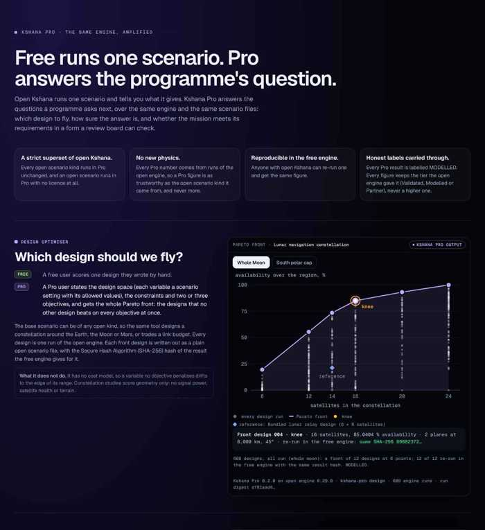 | 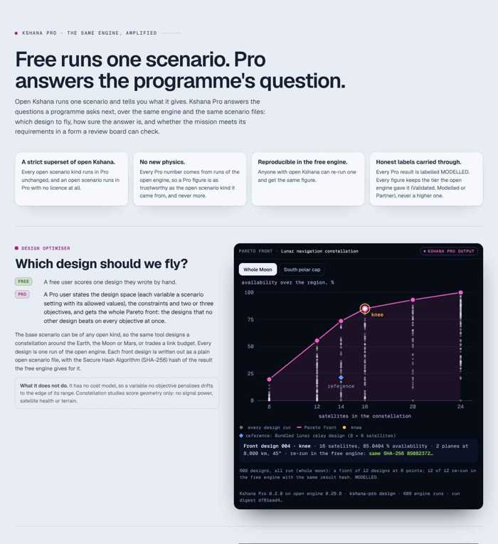 |
| Home Pro band (light) | 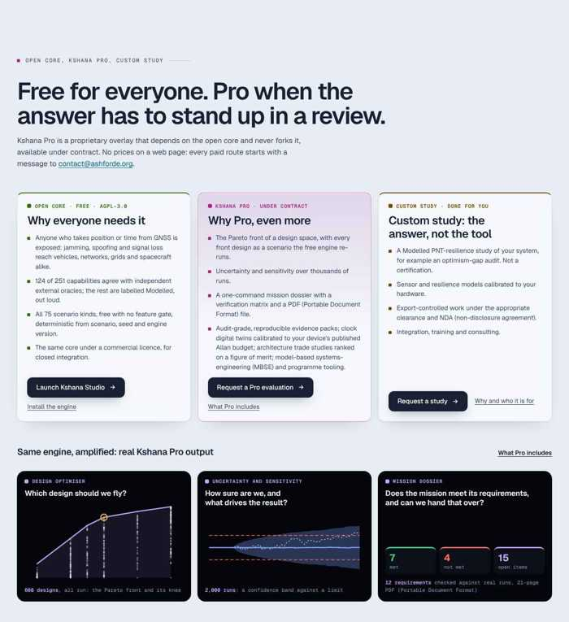 | 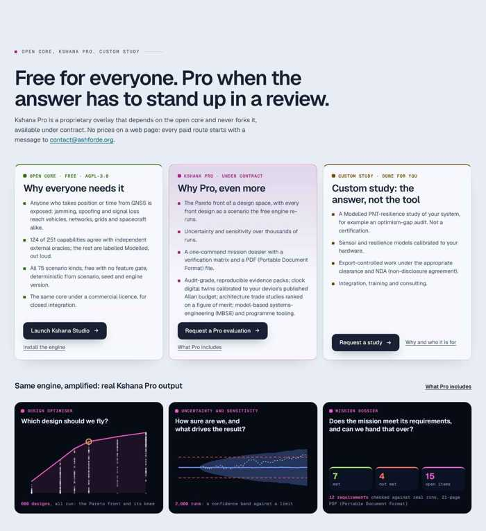 |
| Missions, four pictures (light) | 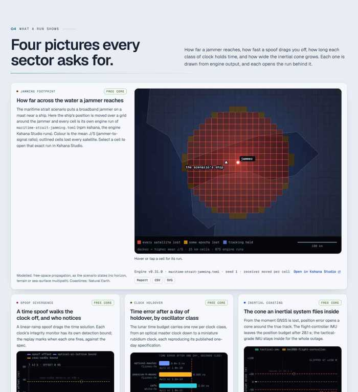 | 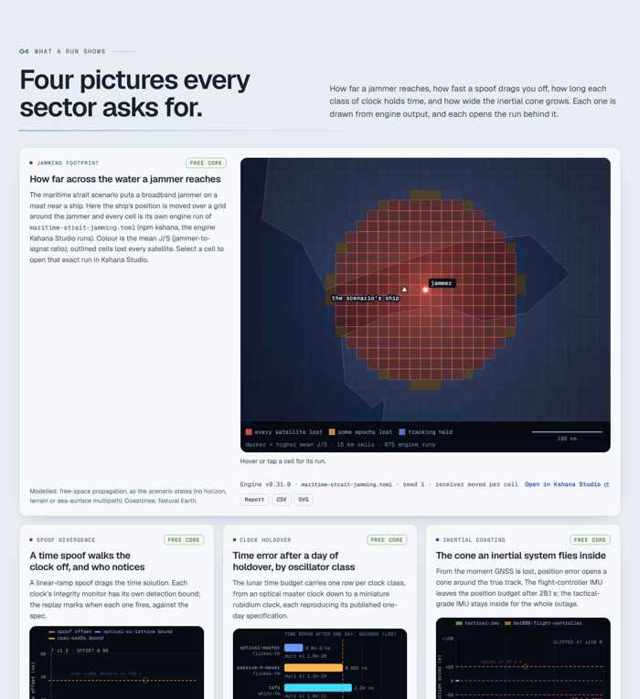 |
| Missions, four pictures (dark) | 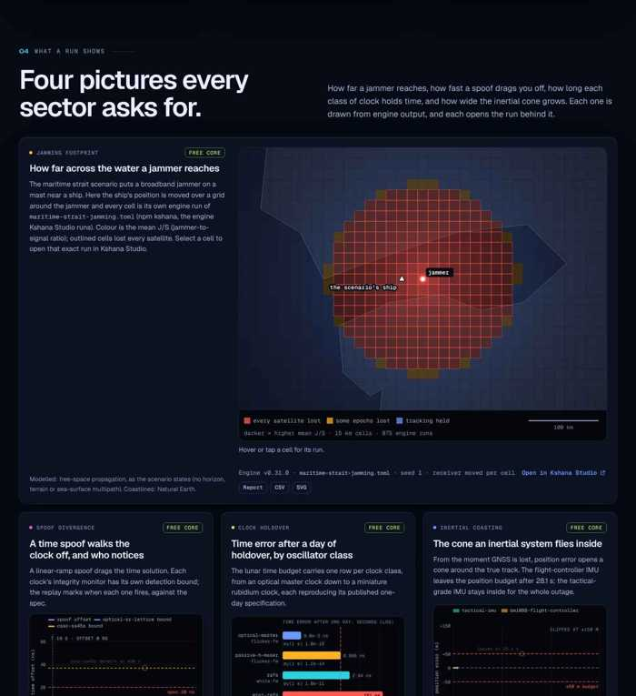 | 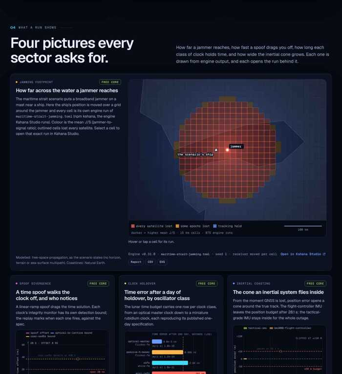 |
| Missions, six failure cards (light) |  | 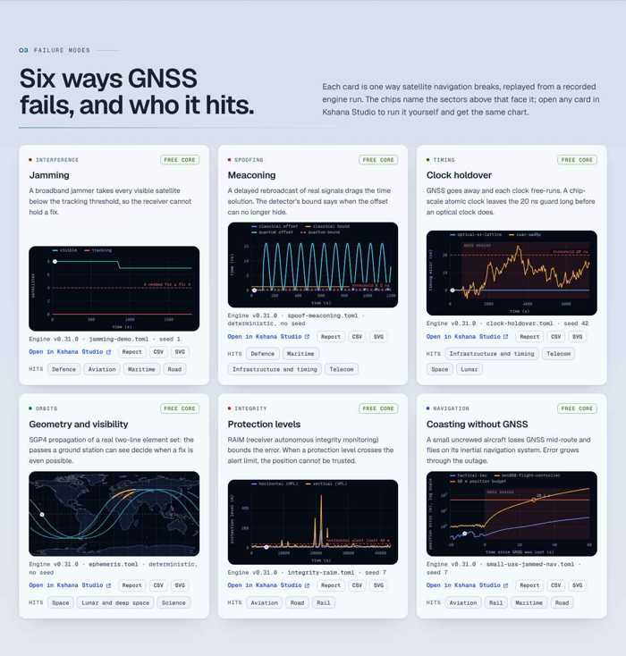 |
| Capabilities consoles (light) | 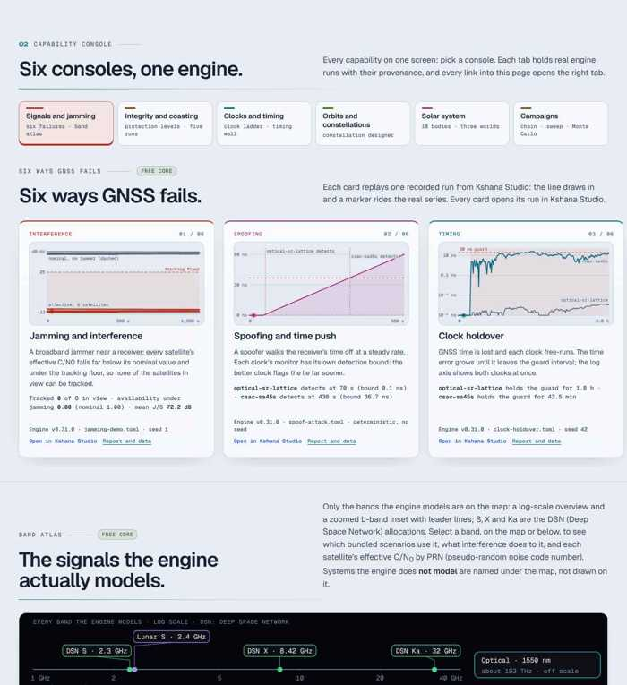 | 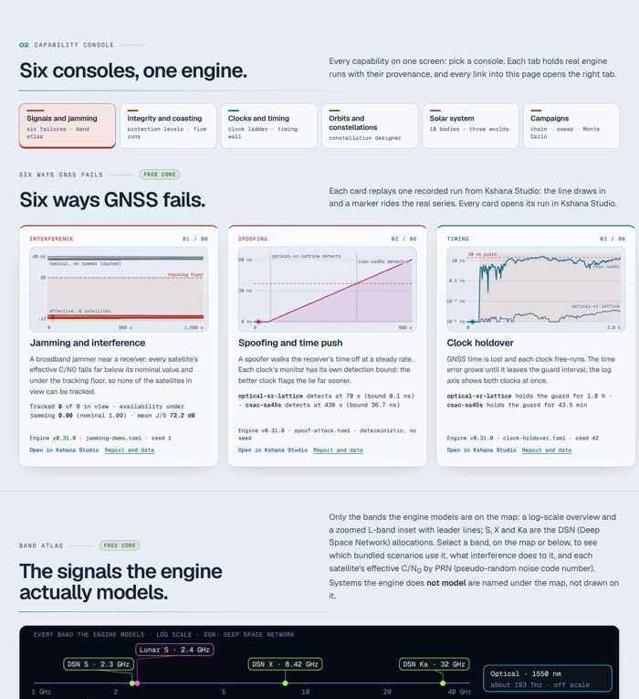 |
| Studio (light) | 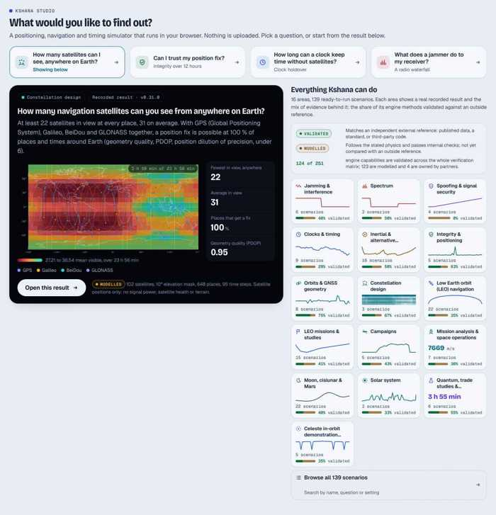 | 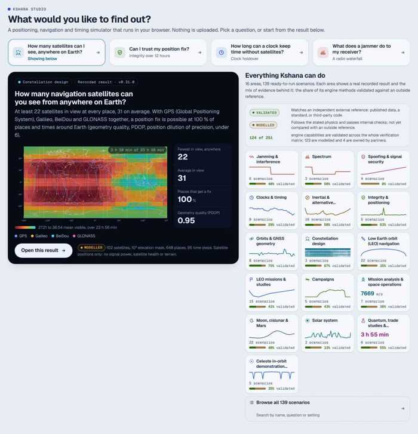 |
| Studio (dark) | 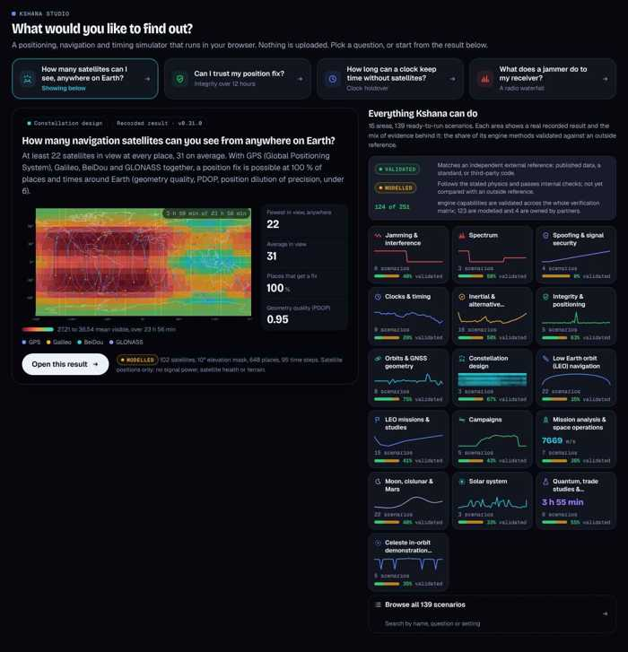 | 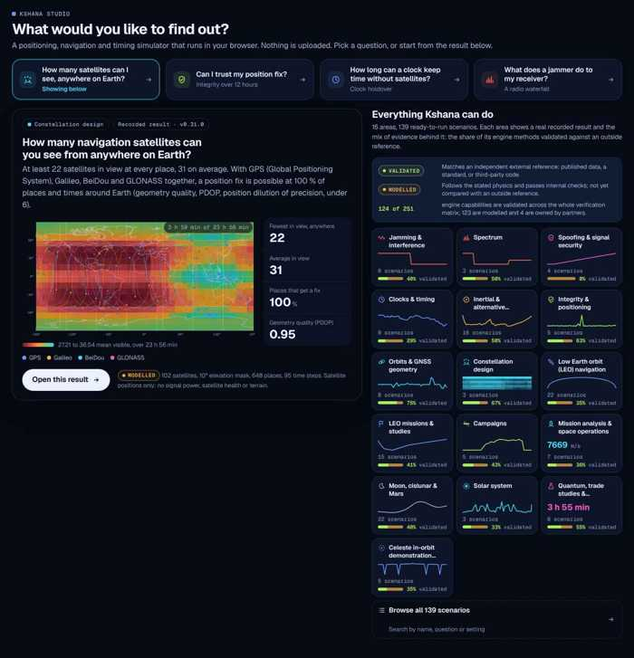 |

Editions `#pro`, the whole section after the change: [light](editions-pro-full-light-after.jpg) · [dark](editions-pro-full-dark-after.jpg).
